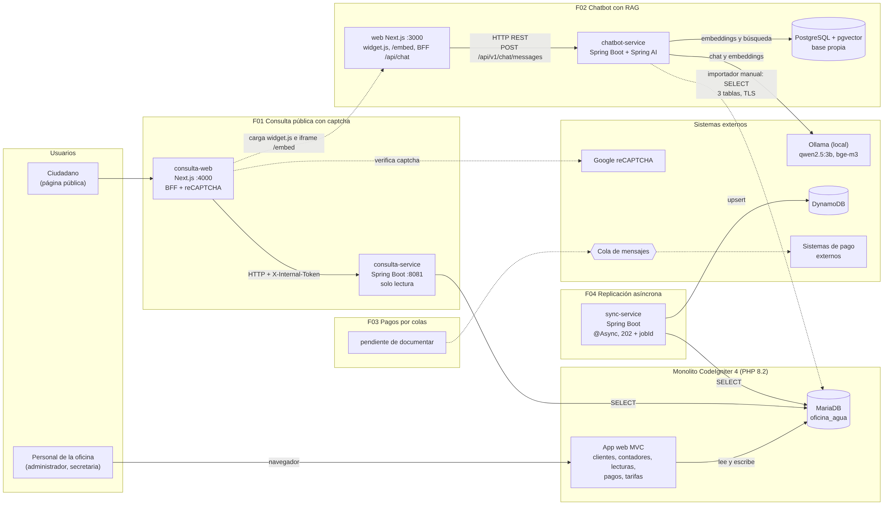
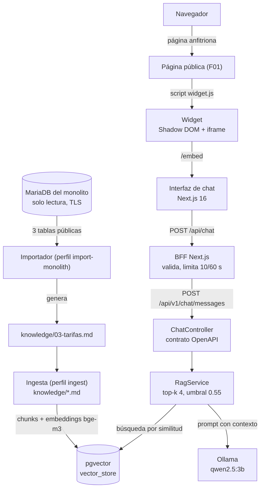
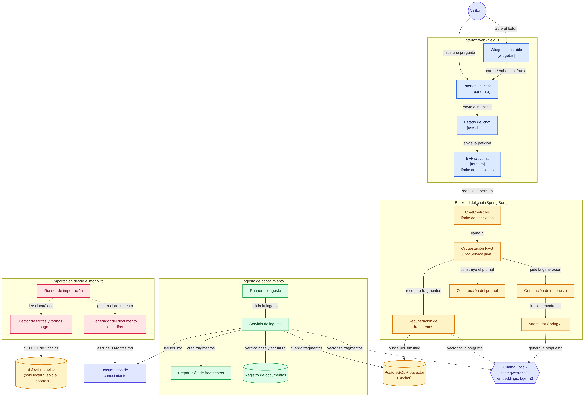

Nombre: Dany Miguel Mateo Hernández
Carnet: 0905-23-19399
Repositorio: https://github.com/Dany164/oficina-agua-f02-chatbot-rag
Modulo asignado: Chatbot con RAG

# Oficina de Agua · Fase 2 · F02 Chatbot con RAG

Chatbot de la página pública de la Oficina de Agua. Responde preguntas con información institucional recuperada
mediante RAG (Retrieval-Augmented Generation) y no solo con el conocimiento general del modelo.

> Este documento se elaboró con ayuda de IA (Claude) y se verificó contra el código real de los repositorios de la solución.

## 1. Contexto: la solución completa

La solución es un **monolito** más **cuatro funcionalidades nuevas** (F01 a F04). Cada funcionalidad vive en su propio
repositorio y se ejecuta de forma independiente.

| Componente | Qué es | Repositorio |
|---|---|---|
| Monolito | Sistema de la oficina: CodeIgniter 4 (PHP 8.2) y MariaDB. Pantallas con login para clientes, contadores, lecturas, pagos y tarifas. | https://github.com/Dany164/sistema-oficina-agua |
| F01 Consulta pública con captcha | `consulta-service` (Spring Boot, solo lectura) y `consulta-web` (Next.js con reCAPTCHA). | https://github.com/Dansosa18/Consulta_Publica_Con_Captcha |
| **F02 Chatbot con RAG (este repositorio)** | `backend/` (Spring Boot + Spring AI + pgvector) y `web/` (Next.js, BFF y widget). | https://github.com/Dany164/oficina-agua-f02-chatbot-rag |
| F03 Envío de pagos por colas | `pagos-producer` (Spring Boot): toma los pagos cobrados, los publica en una cola de Kafka y los envía a un banco simulado con reintentos. | https://github.com/Luisardium/pagos-producer-service |
| F04 Replicación asíncrona | `sync-service` (Spring Boot): replica contadores y lecturas hacia DynamoDB con un trabajo asíncrono. | https://github.com/EdgarFive/oficina-agua-f04-sync-service |

Este diagrama muestra dónde encaja F02 dentro de la solución. El diagrama propio del módulo, con su detalle interno, está en la
sección 4.1. Los demás módulos se representan a alto nivel, según sus repositorios públicos.



Lectura del diagrama (línea continua: relación implementada en el código; línea punteada: relación ocasional):

- **Monolito:** escribe y lee su base MariaDB. No expone una API: sus rutas son pantallas con sesión y roles.
- **Las funcionalidades no llaman al monolito por HTTP.** Se relacionan con él **por su base de datos**. F01, F02 y F04
  solo leen, con usuarios que tienen únicamente `SELECT`; F03 trabaja con la tabla de pagos.
- **F01:** la persona consulta desde `consulta-web`, que verifica el reCAPTCHA con Google y llama a `consulta-service`.
  Esta página es también la anfitriona del widget del chatbot.
- **F02:** el widget de la página pública abre el chat. El BFF de Next.js llama al backend, que busca en pgvector y
  genera la respuesta con Ollama.
- **F04:** `sync-service` lee contadores y lecturas y los copia a DynamoDB mediante un trabajo asíncrono (respuesta `202`
  con un `jobId` que se consulta después). Usa un pool de hilos de Spring, no una cola de mensajes.
- **F03:** `pagos-producer` lee los pagos pendientes, los publica en Kafka y un consumidor los envía por HTTP al banco simulado del docente, con reintentos y una cola de errores.

> Nota de alcance: en los repositorios de F01 y F04 las bases de datos de prueba son copias propias con datos de ejemplo
> (por Docker), con las tablas que cada módulo necesita. Cada módulo se ejecuta de forma independiente y su procedimiento está en su
> propio README.

## 2. Integración entre componentes

| Origen | Destino | Cómo se comunican |
|---|---|---|
| Página pública (F01) | Widget de F02 | La página carga `widget.js` con una etiqueta `<script>`. El widget abre `/embed` en un iframe protegido con `frame-ancestors` (variable `WIDGET_ALLOWED_ORIGINS`). |
| Navegador | BFF de F02 | `POST /api/chat` (JSON). El navegador nunca habla con el backend ni con el modelo. |
| BFF (Next.js) | Backend de F02 | HTTP REST, contrato OpenAPI `POST /api/v1/chat/messages`. |
| Backend de F02 | PostgreSQL + pgvector | JDBC. Base propia del chatbot, con migraciones Flyway. |
| Backend de F02 | Ollama | HTTP local, modelos `qwen2.5:3b` (chat) y `bge-m3` (embeddings). Sin llaves ni servicios externos de pago. |
| Importador de F02 | Monolito (MariaDB) | JDBC de solo lectura con TLS verificado. Lee solo tarifas, tipos de servicio y formas de pago. Se ejecuta a mano. |
| F01 | Monolito (MariaDB) | JDBC de solo lectura (`consulta_ro`). |
| F04 | Monolito (MariaDB) y DynamoDB | Lectura JDBC y escritura (upsert) en DynamoDB. |

## 3. Cómo ejecutar la solución

No hay un `docker-compose` único. Cada módulo se levanta con el procedimiento de su propio repositorio (ver la tabla de la
sección 1). Para este módulo, ver la sección 4.4.

## 4. Módulo asignado: Chatbot con RAG

### 4.1 Funcionalidad y objetivo

El chatbot responde preguntas de ciudadanos (horarios, requisitos para una conexión, tarifas, formas de pago, reporte de
fugas) usando solo documentos de la oficina. Si la pregunta no se relaciona con esos documentos, responde que no tiene
información suficiente y no inventa. Cada respuesta indica las fuentes usadas.

Flujo de una pregunta:



Detalle interno del módulo (clases y archivos principales, ingesta e importación desde el monolito):



1. **Ingesta (una vez):** los documentos de `knowledge/` se parten en fragmentos, se convierten en vectores con `bge-m3`
   y se guardan en pgvector.
2. **Consulta:** el backend convierte la pregunta en un vector y recupera los 4 fragmentos más parecidos con similitud mínima
   de 0.55. Si ninguno la alcanza, responde con una frase fija **sin llamar al modelo**.
3. **Respuesta:** si hay fragmentos, `qwen2.5:3b` redacta la respuesta con un prompt restrictivo que solo permite usar ese
   contexto, y el backend devuelve `answer` y `sources`.

### 4.2 Integración y responsabilidades

| Componente | Responsabilidad | Dónde está |
|---|---|---|
| Widget y página `/embed` | Mostrar el chat dentro de otra página sin mezclar su código ni sus estilos. | `web/public/widget.js`, `web/app/embed` |
| BFF Next.js | Validar el mensaje (máximo 500 caracteres), limitar peticiones por cliente y ocultar el backend. | `web/app/api/chat/route.ts` |
| Backend Spring Boot | Contrato OpenAPI, búsqueda RAG, manejo de errores (400, 429, 503) y límite de peticiones. | `backend/` |
| PostgreSQL + pgvector | Guardar los vectores y el registro de documentos ya indexados. Base propia, separada del monolito. | `docker-compose.yml` |
| Ollama | Generar embeddings y respuestas en el equipo local. | Instalado en el equipo |
| Importador | Traer tarifas reales del monolito y generar `knowledge/03-tarifas.md`. | `backend/.../service/monolith` |

Límites del módulo: no modifica el monolito, no guarda datos de clientes y no necesita el monolito encendido para
responder (usa el documento ya generado).

### 4.3 Decisión técnica

**Importar datos del monolito con un proceso de solo lectura en vez de consultarlo en cada pregunta (D-19).**

- *Alternativas:* consultar el monolito en cada pregunta, escribir las tarifas a mano o importarlas a un documento.
- *Decisión:* un importador manual, de solo lectura, que genera `knowledge/03-tarifas.md` y luego se indexa.
- *Por qué:* el chat sigue funcionando con el monolito apagado, el servicio público no guarda credenciales del monolito
  y las cifras son reales y no escritas a mano. El usuario `chatbot_ro` solo puede leer tres tablas públicas y la conexión usa TLS.
- *Costo:* los datos quedan atrasados hasta volver a importar.

Todas las decisiones (RAG explícito, Contract-First, BFF, límite de peticiones, Docker, widget) están en
[`docs/decisiones-arquitectura.md`](docs/decisiones-arquitectura.md).

### 4.4 Instrucciones para probar

Requisitos: Docker Desktop y [Ollama](https://ollama.com) abiertos (abre Ollama antes que Docker), Node.js 22.

1. Descargar los modelos (una sola vez): `ollama pull bge-m3` y `ollama pull qwen2.5:3b`.
2. Copiar `.env.example` a `.env` y definir `POSTGRES_PASSWORD` con una contraseña propia.
3. Levantar la base y el backend: `docker compose up -d --build` (el backend queda en `http://localhost:8081`).
4. Cargar la base de conocimiento: `docker compose run --rm -e SPRING_PROFILES_ACTIVE=ingest backend`.
5. Levantar la web:

   ```bash
   cd web
   printf 'CHATBOT_API_URL=http://localhost:8081\n' > .env.local
   npm install
   npm run build && npm run start
   ```

6. Abrir `http://localhost:3000` (chat completo) o `http://localhost:3000/demo-captcha.html` (widget dentro de una página).

Datos de prueba y resultado esperado:

| Pregunta | Resultado esperado |
|---|---|
| ¿Cuánto cuesta el servicio de 1/2 paja? | Q 150.00, con la fuente de tarifas. |
| ¿Cuántos litros incluye el servicio de 1/2 paja? | 60,000 litros de consumo al mes. |
| ¿Hay recargo por pagar tarde? | No hay recargo ni mora. |
| ¿Cuál es la capital de Francia? | Dice que no tiene información suficiente y no muestra fuentes. |

Limitación conocida: los cálculos con exceso de consumo (por ejemplo, 20,001 litros) dependen de la aritmética del modelo local
`qwen2.5:3b`, que a veces se equivoca aunque los datos recuperados sean correctos. Con `qwen2.5:7b` acierta, pero en un equipo
sin GPU suficiente tarda hasta 16 segundos. Datos directos (tarifas, horarios, formas de pago, recargos) responden de forma estable.

Prueba directa del backend: `curl -s -X POST http://localhost:8081/api/v1/chat/messages -H "Content-Type: application/json" -d '{"message":"Cual es el horario de atencion?"}'`.
Detener todo: `docker compose down`.

Para ver el widget dentro de la página pública de F01, en `web/.env.local` agrega
`WIDGET_ALLOWED_ORIGINS=http://localhost:4000`, y en F01 el `src` del script del widget (`consulta-web/src/app/layout.tsx`) debe apuntar a `http://localhost:3000/widget.js`.

---

## 5. Referencia técnica detallada de F02

Lo que sigue es la guía completa de configuración, variables y pruebas del módulo.

### Requisitos

- JDK 17, Node.js 22 y Docker Desktop. Docker debe estar abierto también para correr
  los tests del backend (usan Testcontainers con PostgreSQL + pgvector).
- [Ollama](https://ollama.com) instalado en el equipo, con los modelos descargados:
  `ollama pull bge-m3` (embeddings) y `ollama pull qwen2.5:3b` (chat). En equipos con más de 4 GB de VRAM
  se puede usar `qwen2.5:7b` definiendo `OLLAMA_CHAT_MODEL`.

### Configuración

Copiar `.env.example` a `.env` y definir `POSTGRES_PASSWORD`. El archivo `.env` no se sube a Git.

El backend lee estas variables de entorno (solo `POSTGRES_PASSWORD` es obligatoria):

| Variable | Valor por defecto |
|---|---|
| `POSTGRES_PASSWORD` | *(sin valor; obligatoria)* |
| `POSTGRES_HOST` / `POSTGRES_PORT` | `localhost` / `5433` |
| `POSTGRES_DB` / `POSTGRES_USER` | `chatbot` / `chatbot` |
| `OLLAMA_BASE_URL` | `http://localhost:11434` |
| `OLLAMA_EMBEDDING_MODEL` | `bge-m3` |
| `OLLAMA_CHAT_MODEL` | `qwen2.5:3b` |
| `KNOWLEDGE_PATH` | `../knowledge` (relativa a `backend/`) |
| `RAG_TOP_K` | `4` |
| `RAG_SIMILARITY_THRESHOLD` | `0.55` (por debajo, el fragmento se descarta) |
| `RAG_MAX_CONTEXT_CHARS` | `6000` |
| `RATE_LIMIT_MAX_REQUESTS` | `10` (peticiones por cliente y ventana) |
| `RATE_LIMIT_WINDOW_SECONDS` | `60` |
| `RATE_LIMIT_TRUST_FORWARDED_FOR` | `false` (solo `true` si el backend es accesible únicamente a través del BFF) |

El BFF de `web/` lee estas variables solo en el servidor (ejemplo en `web/.env.example`; para cambiarlas, créalo como
`web/.env.local`):

| Variable | Valor por defecto |
|---|---|
| `CHATBOT_API_URL` | `http://localhost:8080` (URL del backend) |
| `CHATBOT_TIMEOUT_MS` | `30000` |
| `BFF_RATE_LIMIT_MAX_REQUESTS` | `10` (peticiones por cliente y ventana) |
| `BFF_RATE_LIMIT_WINDOW_SECONDS` | `60` |
| `BFF_TRUST_PROXY_HEADERS` | `false` (solo `true` detrás de un proxy de confianza) |

### Cómo ejecutar (desarrollo)

Desde la raíz del repositorio, con Docker Desktop y Ollama abiertos:

```bash
docker compose up -d postgres             # solo PostgreSQL + pgvector en el puerto 5433
export POSTGRES_PASSWORD='<la de tu .env>'
cd backend
./mvnw clean verify                       # compila, genera el código del contrato y corre los tests
```

#### Cargar la base de conocimiento (ingesta)

Los documentos de `knowledge/` se convierten en embeddings y se guardan en pgvector:

```bash
./mvnw spring-boot:run -Dspring-boot.run.profiles=ingest
```

La aplicación procesa los documentos y termina sola. La ingesta es idempotente: un documento
cuyo contenido no cambió se omite (no se vuelve a llamar a Ollama), y uno modificado reemplaza sus chunks.

#### Importar tarifas y formas de pago desde el monolito

`knowledge/03-tarifas.md` se genera con los datos reales del monolito (tarifas vigentes, regla del exceso y formas de pago).
No se edita a mano. Necesita el monolito encendido, tu IP autorizada, las variables `MONOLITH_DB_*` en el `.env`
(ver `.env.example`) y el certificado en `secrets/oficina-agua-ca.pem`. Desde `backend/`:

```bash
set -a && source ../.env && set +a
SPRING_PROFILES_ACTIVE=import-monolith,ingest ./mvnw spring-boot:run
```

La importación es de solo lectura (usuario `chatbot_ro`, TLS verificado) y termina sola; la ingesta que sigue indexa el documento nuevo.
El chat no necesita el monolito encendido: usa el documento ya generado. Vuelve a ejecutarlo cuando cambien las tarifas y revisa
el resultado con `git diff knowledge/03-tarifas.md` antes de commitearlo. Ver D-19 en `docs/decisiones-arquitectura.md`.

#### Probar el chat

Con la base cargada, arranca el backend (el puerto 8080 debe estar libre):

```bash
./mvnw spring-boot:run
```

Y desde otra terminal:

```bash
curl -s -X POST http://localhost:8080/api/v1/chat/messages \
  -H "Content-Type: application/json" \
  -d '{"message":"Cual es el horario de atencion?"}'
```

La respuesta trae `answer` y `sources`. Si la pregunta no se relaciona con la base de conocimiento, el chatbot responde
que no tiene información suficiente y `sources` viene vacío. La primera consulta tarda más porque Ollama carga los modelos.

Códigos de error: `400` (mensaje vacío, en blanco o de más de 500 caracteres) y `503` (Ollama o PostgreSQL no disponibles).

#### Ejecutar el backend con Docker

También puedes correr PostgreSQL y el backend juntos, sin instalar Java ni Maven. Desde la raíz del repositorio, con Docker
Desktop y Ollama abiertos y `POSTGRES_PASSWORD` definida en `.env`:

```bash
docker compose up -d --build              # PostgreSQL + backend; el backend queda en http://localhost:8081
docker compose logs -f backend            # seguir el arranque (Ctrl+C para salir)
```

La primera construcción tarda varios minutos porque descarga las imágenes y las dependencias; las siguientes reutilizan
la caché. El backend se publica en el puerto 8081 (cámbialo con `BACKEND_PORT` en `.env`). Dentro de Docker se conecta a
PostgreSQL por el nombre del servicio y a Ollama, que sigue corriendo en tu equipo, por `http://host.docker.internal:11434`
(cámbialo con `OLLAMA_BASE_URL`).

Para cargar la base de conocimiento desde el contenedor (la carpeta `knowledge/` se monta en solo lectura):

```bash
docker compose run --rm -e SPRING_PROFILES_ACTIVE=ingest backend
```

Para que la web use este backend, define `CHATBOT_API_URL=http://localhost:8081` en `web/.env.local`. Para detener todo:
`docker compose down` (los datos se conservan en el volumen; `docker compose down -v` los borra).
#### Probar el BFF (Next.js)

Con el backend en marcha, en otra terminal:

```bash
cd web
npm install
npm run dev                               # http://localhost:3000
```

Si el backend corre en otro puerto (por ejemplo `SERVER_PORT=8081`), indícalo así:
`CHATBOT_API_URL=http://localhost:8081 npm run dev`.

```bash
curl -s -X POST http://localhost:3000/api/chat \
  -H "Content-Type: application/json" \
  -d '{"message":"Cual es el horario de atencion?"}'
```

El BFF responde lo mismo que el backend (`answer` y `sources`). Errores: `400` (mensaje inválido), `429` (demasiadas
peticiones, con `Retry-After`) y `503` (backend no disponible). Los tests se corren con `npm test`.

Nota: si llamas al backend directamente desde Git Bash con tildes, puede responder `400` por la codificación de la consola;
prueba sin tildes o a través del BFF.

#### Probar la interfaz de chat

Con el backend y el BFF en marcha, abre `http://localhost:3000`. Si el backend corre en otro puerto, guarda la dirección una vez
en `web/.env.local` (el archivo está ignorado por Git) y reinicia `npm run dev`:

```bash
printf 'CHATBOT_API_URL=http://localhost:8081\n' > web/.env.local
```

La pantalla muestra las preguntas sugeridas, un indicador mientras se busca la respuesta, las fuentes usadas (como etiquetas
desplegables, no como enlaces) y, ante un error, un aviso con el botón **Reintentar**; con un `429` el botón se habilita al
terminar la cuenta regresiva. En escritorio la mascota sigue el puntero. Las decisiones de diseño están en
`docs/decisiones-arquitectura.md` (D-16).

Si llamas al backend con `curl` desde Git Bash y la pregunta lleva tildes, usa escapes JSON, por ejemplo
`\u00bfCu\u00e1l es el horario?`, o prueba a través del BFF.

#### Incrustar el chat como widget

El chat también puede mostrarse como un botón flotante dentro de otra página, por ejemplo la página pública con captcha. La
página anfitriona solo añade una línea con la dirección donde corre `web/`:

```html
<script src="http://localhost:3000/widget.js" defer></script>
```

El botón abre `/embed` (solo el chat) en un iframe, y se cierra con el mismo botón o con Escape. Para que otro sitio pueda
incrustarlo hay que permitir su origen en `web/.env.local` y reiniciar `npm run dev`:

```bash
WIDGET_ALLOWED_ORIGINS=http://localhost:5000
```

Sin esa variable solo se puede incrustar desde el propio sitio. Para probarlo sin la página real, abre
`http://localhost:3000/demo-captcha.html` (mismo origen) o sirve una página propia en otro puerto con la línea anterior. Las
decisiones están en `docs/decisiones-arquitectura.md` (D-18).

### Estado

Completo para la demostración local. El historial en DynamoDB es opcional y no se implementó.

- Backend: contrato OpenAPI (Contract-First), manejo de errores, PostgreSQL + pgvector con Flyway, Ollama, ingesta idempotente, consulta RAG (umbral de similitud, prompt restrictivo, errores 400, 503 y 500), rate limiting por IP (429 con `Retry-After`) y Docker.
- Datos reales: tarifas, tipos de servicio y formas de pago importados del monolito en solo lectura (D-19), y reglas de pago confirmadas por el equipo del monolito.
- Web: BFF en Next.js (`POST /api/chat`), pantalla de chat generada con v0 y widget embebible para la página pública (`/embed` y `widget.js`).
- Pendiente: historial en DynamoDB (opcional).
- Limitaciones conocidas: el cálculo de totales con exceso puede fallar con el modelo pequeño, la importación del monolito es manual, los documentos 01, 02 y 05 de `knowledge/` siguen siendo de prueba y el widget solo se probó en local.
